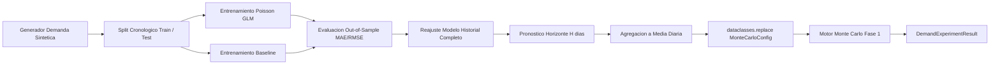

# Modelo Predictivo y Coordinación con Monte Carlo: AI Monte Carlo Lab (Fase 2)

## 1. Introducción y Alcance

Este documento describe la arquitectura estadística, matemática y de software correspondiente a la **Fase 2 de AI Monte Carlo Lab**. El objetivo principal es formular e implementar un pipeline predictivo de demanda diaria de inferencia en LLMs, evaluarlo rigurosamente mediante partición cronológica sin filtración temporal (*data leakage*), y transferir sus proyecciones al motor de simulación de Monte Carlo desarrollado en la Fase 1.

> [!WARNING]
> **Declaración Obligatoria de Datos Sintéticos:**
> Las series temporales diarias generadas por el módulo `ai_monte_carlo.data.demand` provienen exclusivamente de un proceso estocástico paramétrico controlado mediante `numpy.random.default_rng`. **No constituyen registros de telemetría productiva real**, sino una aproximación matemática sintética estructurada para calibración, validación empírica y pruebas de esfuerzo.

---

## 2. Generador de Demanda Diaria Sintética

Para modelar la demanda histórica de solicitudes recibidas por una plataforma de inferencia, se diseña un proceso generador temporal $Y_t \in \mathbb{N}_0$ para cada día $t \in \{0, 1, \dots, T - 1\}$.

### 2.1. Componentes del Proceso Generador

La demanda esperada diaria $\mu(t) = \mathbb{E}[Y_t]$ se compone de una tendencia determinista combinada multiplicativamente con factores estacionales semanales:

$$\mu(t) = \max\left(0, \; (\text{base\_demand} + \beta_{\text{trend}} \cdot t) \cdot s_{\text{dow}(t)}\right)$$

Donde:
- $\text{base\_demand} \ge 0$: Volumen medio inicial de solicitudes en el día $t = 0$.
- $\beta_{\text{trend}} \in \mathbb{R}$: Pendiente de crecimiento o decrecimiento lineal diario (adopción del servicio).
- $\text{dow}(t) \in \{0, 1, \dots, 6\}$: Día de la semana correspondiente a la fecha ($0 = \text{Lunes}, \dots, 6 = \text{Domingo}$).
- $s_d \ge 0$: Multiplicador estacional relativo para el día $d$, permitiendo modelar caídas de tráfico durante fines de semana y picos en días laborales.

### 2.2. Modelo de Ruido Discreto y Conteos Enteros

Dado que las solicitudes son eventos puntuales discretos ($Y_t \in \{0, 1, 2, \dots\}$), las observaciones se muestrean según una distribución de conteo paramétrica:

1. **Poisson (predeterminado):**
   $$Y_t \sim \text{Poisson}(\lambda = \mu(t)), \quad \mathbb{P}(Y_t = k) = \frac{\mu(t)^k e^{-\mu(t)}}{k!}$$
   Garantiza conteos no negativos e integer-typed con $\text{Var}(Y_t) = \mu(t)$.

2. **Binomial Negativa (sobredispersión por ráfagas):**
   $$Y_t \sim \text{NegBinomial}(\mu(t), \alpha), \quad \text{Var}(Y_t) = \mu(t) + \alpha \mu(t)^2$$
   Permite representar mayor volatilidad estocástica o clustering de tráfico.

3. **Determinista (Fixed):**
   $$Y_t = \lfloor \mu(t) \rceil$$
   Permite pruebas analíticas exactas y verificación determinista.

---

## 3. Ingeniería de Características y Prevención de Filtración Temporal

### 3.1. Partición Cronológica Estricta

Las series temporales poseen una dependencia secuencial unidireccional (la información solo fluye del pasado al futuro). La partición tradicional aleatoria (*random shuffle split*) introduce **filtración temporal destructiva**, pues permite que observaciones del futuro informen predicciones del pasado.

En este diseño, la función `temporal_train_test_split` impone:
- Conjunto de Entrenamiento: $\mathcal{D}_{\text{train}} = \{ (X_t, Y_t) \}_{t=0}^{T_{\text{split}} - 1}$
- Conjunto de Prueba: $\mathcal{D}_{\text{test}} = \{ (X_t, Y_t) \}_{t=T_{\text{split}}}^{T - 1}$
- Invariante temporal estricto: $\max(t \in \mathcal{D}_{\text{train}}) < \min(t \in \mathcal{D}_{\text{test}})$, garantizando una frontera sin solapamiento ni fuga de información.

```
Historial Completo (T días):
[================= ENTRENAMIENTO (80%) =================][===== PRUEBA (20%) =====]
t=0                                                t=T_split                     t=T
               (Ajuste del Modelo)                   (Evaluación Fuera de Muestra)
```

### 3.2. Espacio de Características Causal

Las covariables $X_t$ empleadas se limitan estrictamente a variables de calendario conocidas deterministamente para cualquier instante futuro:
1. `time_index` ($t$): Índice continuo que modela la evolución temporal / tendencia secular.
2. `dow_1` a `dow_6`: Variables indicatrices binarias (*dummies*) para Martes (1) a Domingo (6). Lunes (0) se fija como categoría base de referencia para asegurar que la matriz de diseño tenga rango completo frente al término de intercepto $\beta_0$.

No se incorporan características rezagadas autorregresivas que requieran valores no observados en horizontes multietapa sin recursión.

---

## 4. Modelo Predictivo: Regresión Generalizada de Poisson (GLM)

### 4.1. Justificación Frente a Mínimos Cuadrados Ordinarios (MCO / OLS)

El uso de regresión lineal estándar por MCO para predecir volúmenes de solicitudes presenta serios inconvenientes teóricos:
1. **Riesgo de Predicciones Negativas:** MCO puede producir $\hat{Y} < 0$, violando el espacio muestral de solicitudes $\mathbb{N}_0$.
2. **Heterocedasticidad:** En procesos de conteo, la varianza crece naturalmente con la media ($\text{Var}(Y) \propto \mathbb{E}[Y]$), violando el supuesto de homocedasticidad de Gauss-Markov.
3. **Estructura Multiplicativa:** Los efectos estacionales actúan como factores porcentuales sobre la tendencia base, requiriendo una formulación log-lineal.

### 4.2. Formulación Matemática de PoissonRegressor

Se utiliza un Modelo Lineal Generalizado (GLM) con función de enlace canónica logarítmica (*log-link*):

$$\ln(\mathbb{E}[Y_t \mid X_t]) = \beta_0 + \beta_{\text{trend}} \cdot t + \sum_{d=1}^6 \gamma_d \mathbb{I}(\text{dow}_t = d)$$

Equivalente en escala natural a:

$$\mathbb{E}[Y_t \mid X_t] = \exp(\beta_0) \cdot \exp(\beta_{\text{trend}} \cdot t) \cdot \prod_{d=1}^6 \exp(\gamma_d)^{\mathbb{I}(\text{dow}_t = d)}$$

- $\exp(\beta_0)$: Demanda esperada en $t = 0$ para el día base (Lunes).
- $\exp(\beta_{\text{trend}} \cdot t)$: Tasa de crecimiento compuesto de la demanda.
- $\exp(\gamma_d)$: Multiplicador estacional relativo del día $d$ frente al Lunes.
- Regularización L2: Minimiza la devianza de Poisson penalizada con parámetro $\alpha = 10^{-4}$ para mitigar colinealidad.

Las predicciones son **estrictamente positivas y acotadas inferiormente por cero**.

---

## 5. Predicción de Referencia (Baseline Model)

Para verificar si el modelo Poisson aporta valor real frente a una heurística trivial, se implementa `BaselineDemandModel`, entrenado **exclusivamente con los datos del conjunto de entrenamiento**:

$$\hat{y}_{\text{baseline}}(t) = \bar{y}_{\text{train, dow}(t)} = \frac{1}{|\mathcal{T}_{d}|} \sum_{i \in \mathcal{T}_{d}} Y_i, \quad \text{donde } \mathcal{T}_d = \{ i \in \mathcal{D}_{\text{train}} : \text{dow}(i) = \text{dow}(t) \}$$

Si algún día de la semana no contara con observaciones en entrenamiento, se utiliza la media global $\bar{Y}_{\text{train}}$.

### Racionalidad de la Comparación
Este estimador de referencia captura la estacionalidad semanal del pasado, pero **ignora por completo la tendencia temporal**. Si la serie temporal experimenta crecimiento o decrecimiento, el modelo Poisson GLM debe superar al baseline al capturar ambos efectos simultáneamente.

---

## 6. Métricas de Evaluación Estadística

La evaluación out-of-sample sobre las $n$ observaciones del conjunto de prueba $\mathcal{D}_{\text{test}}$ utiliza:

### 6.1. Error Absoluto Medio (MAE)
$$\text{MAE} = \frac{1}{n} \sum_{i=1}^n \left| y_i - \hat{y}_i \right|$$
Mide la magnitud promedio del error en las mismas unidades que la variable objetivo (solicitudes diarias).

### 6.2. Raíz del Error Cuadrático Medio (RMSE)
$$\text{RMSE} = \sqrt{\frac{1}{n} \sum_{i=1}^n \left( y_i - \hat{y}_i \right)^2}$$
Penaliza de forma cuadrática las desviaciones grandes, sensible a subestimaciones o sobreestimaciones atípicas.

### 6.3. Devianza Media de Poisson
$$D_{\text{mean}} = \frac{2}{n} \sum_{i=1}^n \left( y_i \ln\left(\frac{y_i}{\hat{y}_i}\right) - (y_i - \hat{y}_i) \right)$$
Función de pérdida canónica para modelos de conteo con $y \ln(y/\hat{y}) = 0$ cuando $y = 0$.

> [!NOTE]
> **Por qué se evita MAPE:**
> El Error Porcentual Absoluto Medio ($\text{MAPE} = \frac{1}{n}\sum |y_i - \hat{y}_i| / y_i$) es matemáticamente indefinido cuando $y_i = 0$ e inestable cuando $y_i$ es pequeño, distorsionando arbitrariamente la evaluación de conteos discretos.

---

## 7. Integración con el Motor Monte Carlo

El servicio `run_demand_experiment` coordina el flujo completo:



### 7.1. Conexión de Parámetros

El pronóstico genera un vector de demandas diarias $\hat{Y}_{T+1}, \dots, \hat{Y}_{T+H}$ para un horizonte de $H$ días (generalmente $H = 30$, coherente con `workload.days_per_month`).

La demanda media proyectada se calcula como:

$$\bar{\lambda}_{\text{diaria}} = \frac{1}{H} \sum_{h=1}^H \hat{Y}_{T+h}$$

Utilizando `dataclasses.replace` sin mutar la configuración original, se crea la configuración efectiva:

```python
new_workload = dataclasses.replace(
    original_config.workload,
    mean_daily_requests=horizon_forecast.mean_daily_demand,
    days_per_month=horizon_days,
)
effective_config = dataclasses.replace(
    original_config,
    workload=new_workload,
)
```

Posteriormente, se invoca `run_monte_carlo(effective_config)`, reutilizando íntegramente las fórmulas de costo, agregaciones vectorizadas compuestas y métricas estadísticas de la Fase 1.

---

## 8. Supuestos y Limitaciones

1. **Aproximación de Homogeneidad Mensual:**
   La Fase 1 modela el total mensual mediante un proceso compuesto parametrizado por la tasa media esperada mensual $\mathbb{E}[N] = D \cdot \bar{\lambda}_{\text{diaria}}$. Reducir el pronóstico diario variable a un escalar promedio representa una aproximación: aún no se simulan trayectorias día a día independientes dentro del mes.
2. **Estabilidad Paramétrica:**
   El modelo asume que los coeficientes de tendencia y estacionalidad se mantienen estables durante el horizonte de pronóstico de 30 días, sin choques estructurales externos imprevistos.
3. **Naturaleza Sintética:**
   Los patrones aprendidos provienen de distribuciones teóricas controladas. La calibración sobre tráfico productivo real requerirá telemetría de inferencia empírica.

---

## 9. Ejecución de Pruebas y Experimento Local

### 9.1. Ejecución de la Suite Automatizada de Pruebas

Desde el directorio `backend`:

```powershell
python -m pytest
```

Resultado verificado:
- **57 pruebas unitarias e integradas exitosas** (32 de la Fase 1 + 25 de la Fase 2).
- Cobertura de reproducibilidad, validación de parámetros, no filtración temporal, finitud de predicciones, comparación con baseline, preservación de inmutabilidad y compatibilidad retrospectiva.

### 9.2. Demostración CLI Completa

Para ejecutar la demostración integrada de ambas fases:

```powershell
python -m ai_monte_carlo
```

### 9.3. Ejemplo de Uso en Código Python

```python
from ai_monte_carlo.config import MonteCarloConfig
from ai_monte_carlo.data.demand import DailyDemandConfig
from ai_monte_carlo.services.experiment import ExperimentConfig, run_demand_experiment

# 1. Configurar experimento
exp_config = ExperimentConfig(
    demand_config=DailyDemandConfig(
        n_days=180,
        base_demand=1200.0,
        trend_slope=2.0,
        seed=42,
    ),
    monte_carlo_config=MonteCarloConfig(
        n_iterations=5_000,
        budget_limit=450.0,
        seed=42,
    ),
    test_size=0.2,
    forecast_days=30,
    seed=42,
)

# 2. Ejecutar experimento coordinado
result = run_demand_experiment(exp_config)

# 3. Acceder a resultados
print(f"MAE Poisson: {result.test_metrics.mae:.2f} solicitudes")
print(f"MAE Baseline: {result.baseline_metrics.mae:.2f} solicitudes")
print(f"Demanda Diaria Pronosticada: {result.horizon_forecast.mean_daily_demand:.2f} req/dia")
print(f"Costo Mensual Esperado: ${result.monte_carlo_result.cost_metrics.mean:.2f} USD")
print(f"P(Costo > Presupuesto): {result.monte_carlo_result.cost_metrics.prob_exceed_budget * 100:.2f}%")
```
