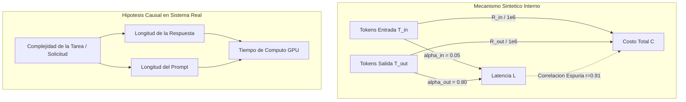

# Validación Estadística Avanzada y Análisis de Incertidumbre: AI Monte Carlo Lab (Fase 3)

## 1. Introducción y Marco Teórico-Metodológico

Este documento formaliza la fundamentación matemática, los procedimientos computacionales y la validación empírica correspondientes a la **Fase 3 de AI Monte Carlo Lab**. El objetivo primordial es proveer un marco riguroso de verificación y análisis de incertidumbre para el motor estocástico de simulación de consumo y costos de inferencia en modelos de lenguaje (LLMs), integrando los desarrollos previos de las Fases 1 y 2.

El trabajo se estructura en cuatro componentes interconectados:
1. **Análisis de Convergencia Numérica:** Caracterización asintótica del error estándar de Monte Carlo ($O(1/\sqrt{n})$) e intervalos de confianza para la media e indicadores de riesgo.
2. **Análisis de Sensibilidad Paramétrica:** Determinación del impacto marginal y elástico de los parámetros del sistema mediante perturbaciones *One-At-a-Time* (OAT) y diagramas Tornado.
3. **Análisis de Correlaciones y Dependencia Conjunta:** Evaluación formal de asociaciones bivariadas (Pearson y Spearman), distinguiendo dependencias estructurales, variables confusoras y supuestos de independencia versus modelos de cópula conjuntos.
4. **Validación Analítica de Sumas Aleatorias Compuestas:** Contrastación estadística formal frente a la Identidad de Wald y la Ley de Varianza Total (Fórmula de Eve) para procesos Poisson, Binomial Negativa y regímenes deterministas.

> [!WARNING]
> **Declaración de Datos Sintéticos y Validez Externa:**
> Los datos generados por `ai_monte_carlo.data.synthetic` y las trayectorias de `run_monte_carlo` se derivan de generadores pseudoaleatorios (`numpy.random.default_rng`) parametrizados teóricamente. Las correlaciones observadas son consecuencia directa de las funciones afines de latencia y combinaciones lineales de costos programadas en el motor, no observaciones empíricas de tráfico en centros de datos reales.

---

## 2. Componente A — Convergencia de Monte Carlo y Cuantificación de la Incertidumbre

### 2.1. Formulación de los Estimadores Asintóticos

Sea $\{C^{(1)}, C^{(2)}, \dots, C^{(M)}\}$ una secuencia de realizaciones independientes e idénticamente distribuidas (i.i.d.) del costo mensual en USD generadas por el motor estocástico. Para cualquier tamaño muestral intermedio $n \le M$ (con $n \ge 2$), se definen:

#### 1. Media Acumulada
$$\bar{C}_n = \frac{1}{n} \sum_{i=1}^n C^{(i)}$$
Por la Ley Fuerte de los Grandes Números (SLLN), $\bar{C}_n \xrightarrow{\text{c.s.}} \mathbb{E}[C]$.

#### 2. Varianza y Desviación Estándar Muestral (Corrección de Bessel)
$$s_n^2 = \frac{1}{n - 1} \sum_{i=1}^n \left(C^{(i)} - \bar{C}_n\right)^2, \qquad s_n = \sqrt{s_n^2}$$
El uso de $ddof = 1$ garantiza la insesgadez del estimador de varianza poblacional ($\mathbb{E}[s_n^2] = \sigma_C^2$).

#### 3. Error Estándar de Monte Carlo (MCSE)
$$\text{SE}(\bar{C}_n) = \frac{s_n}{\sqrt{n}}$$
El error estándar cuantifica exclusivamente la **incertidumbre numérica** atribuible al tamaño finito de la muestra de simulación, decreciendo asintóticamente a una tasa $O(n^{-1/2})$.

#### 4. Intervalo de Confianza para la Media
A un nivel de confianza nominal $1 - \alpha = 0.95$:
- **Distribución $t$ de Student ($df = n - 1$):**
  $$\text{IC}_{95\%}(\mathbb{E}[C]) = \left[ \bar{C}_n - t_{0.975, n-1} \cdot \text{SE}(\bar{C}_n), \; \bar{C}_n + t_{0.975, n-1} \cdot \text{SE}(\bar{C}_n) \right]$$
  *Justificación teórica:* Cuando la varianza poblacional $\sigma_C^2$ es desconocida y se aproxima mediante $s_n^2$, la distribución exacta del estadístico pivote para muestras gaussianas sigue una distribución $t$ de Student. Para muestras moderadas o asimétricas, el Teorema Central del Límite (TCL) y el Teorema de Slutsky garantizan que $t_{0.975, n-1} \to z_{0.975} \approx 1.95996$ a medida que $n \to \infty$. El módulo implementa `method_ci='t'` como predeterminado y `method_ci='normal'` como alternativa asintótica.

#### 5. Probabilidad Acumulada de Exceder el Presupuesto
Dada una cota presupuestaria $B \ge 0$:
$$\hat{p}_n = \frac{1}{n} \sum_{i=1}^n \mathbb{I}\left(C^{(i)} > B\right)$$
Error estándar binomial de Monte Carlo:
$$\text{SE}(\hat{p}_n) = \sqrt{\frac{\hat{p}_n (1 - \hat{p}_n)}{n}}$$

#### 6. Intervalo de Confianza Binomial de Wilson Score
Para proporciones binomiales, el intervalo tradicional de Wald ($\hat{p} \pm z \sqrt{\hat{p}(1-\hat{p})/n}$) exhibe serias deficiencias: colapsa patológicamente a un ancho de cero cuando $\hat{p} = 0$ o $\hat{p} = 1$, y puede producir límites fuera del soporte probabilístico $[0, 1]$.

En su lugar, se implementa el **Wilson Score Interval**:
$$\tilde{p} = \frac{\hat{p}_n + \frac{z^2}{2n}}{1 + \frac{z^2}{n}}$$
$$\text{Margin} = \frac{z}{1 + \frac{z^2}{n}} \sqrt{\frac{\hat{p}_n(1 - \hat{p}_n)}{n} + \frac{z^2}{4n^2}}$$
$$\text{IC}_{95\%}(P(C > B)) = \left[ \max\left(0, \tilde{p} - \text{Margin}\right), \; \min\left(1, \tilde{p} + \text{Margin}\right) \right]$$
Este intervalo garantiza límites estrictamente restringidos al intervalo $[0, 1]$ y una cobertura asintótica conservadora y robusta incluso en escenarios de baja probabilidad (e.g. eventos raros donde el presupuesto nunca fue superado en la muestra).

---

### 2.2. Distinción Estadística Obligatoria entre Tipos de Incertidumbre

En la defensa metodológica ante un comité de ingeniería estadística, es fundamental distinguir los tres tipos de incertidumbre presentes:

| Categoría de Incertidumbre | Métrica Estadística | Dependencia con $n$ (Iteraciones) | Interpretación Física / Operacional |
| :--- | :--- | :--- | :--- |
| **Dispersión / Variabilidad del Sistema** | Desviación Estándar ($s$) y Percentiles ($P_5, P_{95}$) | **No converge a cero** al aumentar $n$; converge a la verdadera dispersión física $\sigma_C$. | Refleja la volatilidad intrínseca del proceso de negocio: variaciones reales en la demanda diaria y fluctuaciones en la extensión de las respuestas de los usuarios. |
| **Incertidumbre Numérica de Estimación** | Error Estándar ($\text{SE}(\bar{C}) = s/\sqrt{n}$) e Intervalos de Confianza de la Media | **Decae a cero** a tasa $O(1/\sqrt{n})$ conforme $n \to \infty$. | Refleja la precisión del cálculo numérico computacional. Puede reducirse arbitrariamente aumentando las replicaciones de simulación. |
| **Incertidumbre Epistémica / de Modelo** | Errores en tarifas, calibración de hiperparámetros, supuestos de independencia | **Invariable frente al número de iteraciones** de Monte Carlo. | Si los supuestos de entrada son erróneos (e.g. tarifas desactualizadas o función de latencia incorrecta), simular 10 millones de iteraciones producirá una estimación numéricamente muy precisa de un valor incorrecto. |

> [!CAUTION]
> **Error Conceptual Crítico:**
> El intervalo de confianza de la media $\text{IC}_{95\%}(\mathbb{E}[C])$ **nunca debe presentarse como un intervalo predictivo del costo mensual**. El intervalo de la media acota dónde se encuentra el parámetro poblacional esperado $\mathbb{E}[C]$, mientras que el rango de variación de los costos de meses individuales está gobernado por el intervalo interpercentil $[P_5, P_{95}]$.

### 2.3. No Monotonicidad de la Trayectoria de Convergencia

Las realizaciones de Monte Carlo son variables aleatorias. Por consiguiente, la secuencia de estimaciones $\{\bar{C}_{n_1}, \bar{C}_{n_2}, \dots\}$ exhibe fluctuaciones estocásticas y **no tiene por qué converger monótonamente** hacia la media teórica en cada checkpoint intermedio. La convergencia debe juzgarse mediante la reducción asintótica de la amplitud del error estándar y la estabilización dentro de las bandas del intervalo de confianza, nunca exigiendo una trayectoria artificialmente suavizada.

---

## 3. Componente B — Análisis de Sensibilidad Paramétrica

### 3.1. Metodología One-At-a-Time (OAT) Inmutable

Para evaluar la influencia de los hiperparámetros en el comportamiento estocástico del modelo, se implementa un análisis de un factor a la vez (*One-At-a-Time*, OAT). A partir de una configuración base congelada $\mathbf{\theta}_0 \in \Theta$ (`MonteCarloConfig`), se generan configuraciones derivadas $\mathbf{\theta}_k^{\pm}$ mediante transformaciones puras con `dataclasses.replace`, asegurando la estricta **inmutabilidad de la configuración original**:

$$\mathbf{\theta}_{k}^{+} = (\theta_{0, 1}, \dots, \theta_{0, k} \cdot (1 + \delta), \dots, \theta_{0, P})$$
$$\mathbf{\theta}_{k}^{-} = (\theta_{0, 1}, \dots, \theta_{0, k} \cdot (1 - \delta), \dots, \theta_{0, P})$$

Donde $\delta$ representa la fracción de perturbación relativa (por defecto $\delta = 0.20$, correspondiente a $\pm 20\%$).

### 3.2. Tratamiento Riguroso de Parámetros con Valor Base Cero

Cuando un parámetro posee un valor nominal base de cero (como el costo fijo mensual $C_{\text{fijo}} = 0.0$ USD), una perturbación multiplicativa relativa produce de forma degenerada $0 \cdot (1 \pm \delta) = 0$.

El módulo detecta explícitamente esta singularidad matemática y aplica una **perturbación aditiva controlada**:
$$\theta_{\text{fijo}}^{+} = \theta_{\text{fijo}, 0} + \Delta_{\text{abs}}$$
Donde $\Delta_{\text{abs}} = 25.0$ USD (configurable mediante `zero_base_step`). El registro documenta formalmente la condición como `additive`, evitando divisiones por cero en el cálculo de elasticidades relativas.

### 3.3. Métricas de Impacto y Elasticidad Normalizada

Para cada factor perturbado, se calculan:
1. **Variación Absoluta y Relativa del Costo Medio:**
   $$\Delta \bar{C} = \bar{C}(\mathbf{\theta}_k) - \bar{C}(\mathbf{\theta}_0), \qquad \%\Delta \bar{C} = \frac{\Delta \bar{C}}{\bar{C}(\mathbf{\theta}_0)} \times 100\%$$
2. **Variación del Percentil 95 ($\Delta P_{95}$):** Mide el impacto en escenarios de estrés financiero.
3. **Variación de la Probabilidad Presupuestaria ($\Delta \hat{P}$):** Cambio en puntos porcentuales de superar la cota de presupuesto.
4. **Elasticidad Local de la Media:**
   $$\varepsilon_k = \frac{\%\Delta \bar{C}}{\%\Delta \theta_k} = \frac{\Delta \bar{C} / \bar{C}_0}{\Delta \theta_k / \theta_{k, 0}}$$
   La elasticidad es adimensional y directamente comparable entre variables con diferentes unidades de medida (e.g. tokens vs dólares vs solicitudes).

### 3.4. Diagrama Tornado y Jerarquía de Factores

El rango de fluctuación total (*swing*) para un factor se define como:
$$\text{Swing}_k = \left| \bar{C}(\mathbf{\theta}_k^+) - \bar{C}(\mathbf{\theta}_k^-) \right|$$

El método `tornado_dataframe()` ordena los parámetros de forma descendente por su $\text{Swing}_k$. En condiciones de mercado típicas con tarificación estándar ($R_{\text{in}} = \$2.50$, $R_{\text{out}} = \$10.00$ por millón):

```
+---------------------------------------------------------------------------------------------------------+
|                                  DIAGRAMA TORNADO: IMPACTO EN COSTO MEDIO                                |
+------------------------------------+--------------------------------------------------------------------+
| Parámetro                          | Rango de Variación del Costo Medio Mensual (USD)                   |
+------------------------------------+--------------------------------------------------------------------+
| workload.mean_daily_requests       | [====================================================] Swing=$12.00|
| output_tokens.mean                 | [====================================]                 Swing=$8.40 |
| pricing.cost_per_million_output    | [====================================]                 Swing=$8.40 |
| pricing.fixed_monthly_cost         | [==============================]                       Swing=$6.00 |
| pricing.cost_per_million_input     | [================]                                     Swing=$3.60 |
| input_tokens.mean                  | [================]                                     Swing=$3.60 |
| output_tokens.std                  | []                                                     Swing=$0.00 |
| input_tokens.std                   | []                                                     Swing=$0.00 |
| workload.dispersion_parameter      | []                                                     Swing=$0.00 |
+------------------------------------+--------------------------------------------------------------------+
```

#### Hallazgos Teóricos Cruciales:
1. **Invarianza de la Media frente a Parámetros de Dispersión:** Por la Identidad de Wald, $\mathbb{E}[C] = \mathbb{E}[N]\mathbb{E}[Z] + C_{\text{fijo}}$. En consecuencia, perturbar las desviaciones estándar de tokens (`input_tokens.std`, `output_tokens.std`) o la sobredispersión de Poisson (`dispersion_parameter`) tiene un impacto nulo ($\text{Swing} \approx 0.00$) sobre el costo medio esperado.
2. **Impacto en Percentiles Extremos ($P_{95}$):** Aunque la dispersión no altera la media, sí incrementa sustancialmente el percentil 95 y la probabilidad de exceder el presupuesto, confirmando la necesidad de simular la distribución completa y no conformarse con cálculos de primer momento.

### 3.5. Números Pseudoaleatorios Comunes (CRN) y sus Limitaciones

Para aislar el efecto de la variación paramétrica del ruido estocástico muestral, las evaluaciones de sensibilidad utilizan la técnica de **Números Aleatorios Comunes** (*Common Random Numbers*, CRN), fijando la misma semilla pseudoaleatoria (`seed=42`) en todas las corridas derivadas.

*Limitación Metodológica Reconocida:*
Al perturbar la demanda diaria (`mean_daily_requests`), el número de solicitudes mensuales generadas $N^{(m)}$ varía. Como consecuencia, el flujo de llamadas al generador de tokens cambia su longitud, desincronizando las trayectorias subsecuentes a nivel individual. Esta es una limitación intrínseca de los procesos de conteo compuestos que no invalida el estimador OAT, pero debe reconocerse al interpretar correlaciones entre corridas.

---

## 4. Componente C — Correlaciones Justificadas y Muestreo Conjunto

### 4.1. Análisis Empírico sobre Telemetría Sintética

El módulo calcula los coeficientes de correlación lineal de **Pearson** ($r$) y de correlación de rangos de **Spearman** ($\rho_s$), acompañados de sus valores $p$ exactos mediante `scipy.stats`.

Evaluación formal sobre una muestra de $N = 2\,000$ solicitudes generadas con `generate_synthetic_requests`:

| Par de Variables | Pearson $r$ | Valor $p$ (Pearson) | Spearman $\rho_s$ | Valor $p$ (Spearman) | Naturaleza Metodológica de la Relación |
| :--- | :---: | :---: | :---: | :---: | :--- |
| `input_tokens` vs `output_tokens` | $+0.0004$ | $0.984$ | $+0.0101$ | $0.651$ | **Independientes por construcción.** Generadas mediante llamadas separadas e incorrelacionadas al generador RNG. La correlación no difiere significativamente de 0. |
| `input_tokens` vs `latency_ms` | $+0.0910$ | $4.6 \times 10^{-5}$ | $+0.0980$ | $1.1 \times 10^{-5}$ | **Dependencia estructural afín débil.** Producida por el término marginal $\alpha_{\text{in}} \cdot T_{\text{in}} = 0.05 \cdot T_{\text{in}}$ en el modelo de latencia. |
| `output_tokens` vs `latency_ms` | $+0.9465$ | $< 10^{-15}$ | $+0.9137$ | $< 10^{-15}$ | **Dependencia estructural afín dominante.** Inducida por $\alpha_{\text{out}} \cdot T_{\text{out}} = 0.80 \cdot T_{\text{out}}$, modelando el costo computacional de la decodificación autorregresiva token por token. |
| `total_tokens` vs `cost_total_usd` | $+0.8078$ | $< 10^{-15}$ | $+0.8320$ | $< 10^{-15}$ | **Combinación lineal determinista.** Identidad contable derivada de la función de tarificación. La correlación es subunitaria solo por la disparidad entre tarifas ($R_{\text{in}} \ne R_{\text{out}}$). |
| `latency_ms` vs `cost_total_usd` | $+0.9134$ | $< 10^{-15}$ | $+0.8691$ | $< 10^{-15}$ | **Asociación espuria por variable confusora común.** Ninguna variable causa a la otra; ambas son funciones crecientes de los tokens generados $T_{\text{out}}$. |

### 4.2. Distinción Epistemológica: Asociación vs Generador vs Causalidad



1. **Asociación Estadística:** Medida de covarianza normalizada observada entre columnas numéricas en un conjunto de datos.
2. **Dependencia Construida por el Generador:** Relación determinista o probabilística inyectada deliberadamente en el código por diseño paramétrico (e.g. la fórmula de latencia).
3. **Relación Causal Real:** En un sistema de producción, la correlación entre prompt y completion suele estar mediada por una variable latente de **complejidad de la tarea**. Prompts complejos de razonamiento (Chain-of-Thought) demandan respuestas más extensas, generando una correlación positiva real que el modelo independiente simplifica.

### 4.3. Escenario Opcional: Muestreo Conjunto Mediante Cópula Gaussiana

Para permitir el modelado de escenarios donde la longitud de entrada condiciona la longitud de salida sin alterar el motor principal, se implementó `sample_joint_tokens`:

#### Algoritmo de Muestreo Conjunto:
1. Se especifica un parámetro de acoplamiento $\rho \in [-1.0, 1.0]$. Si $\rho = 0.0$ (predeterminado), el generador ejecuta el muestreo independiente clásico.
2. Si $\rho \ne 0.0$, se genera un par gaussiano bivariado estándar:
   $$\begin{pmatrix} Z_{\text{in}} \\ Z_{\text{out}} \end{pmatrix} \sim \mathcal{N}_2\left(\begin{pmatrix} 0 \\ 0 \end{pmatrix}, \begin{pmatrix} 1 & \rho \\ \rho & 1 \end{pmatrix}\right)$$
3. **Preservación de Distribuciones Marginales:**
   - Para marginales Log-Normales con momentos deseados $(\mu_X, \sigma_X)$:
     $$Y = \mu_{\ln} + \sigma_{\ln} \cdot Z, \qquad T = \text{clip}\left(\lfloor\exp(Y)\rceil, \; T_{\min}, \; T_{\max}\right)$$
     Esto preserva de forma idéntica la distribución marginal univariada de cada clase de tokens mientras induce una covarianza controlada entre ellas.
   - Para distribuciones generales (Gamma, Normal, Uniforme), se aplica la Transformada de Probabilidad Integral (Cópula Gaussiana): $U = \Phi(Z)$, evaluando el cuantil $F^{-1}(U)$.

---

## 5. Componente D — Comparación con Resultados Analíticos

### 5.1. Teoría de Sumas Aleatorias Compuestas

El costo mensual total de inferencia es un proceso estocástico compuesto:
$$C = \sum_{i=1}^N Z_i + C_{\text{fijo}}$$
Donde $N$ es el conteo mensual de solicitudes y $Z_i = (T_{\text{in}, i} R_{\text{in}} + T_{\text{out}, i} R_{\text{out}}) / 10^6$ es el costo de la $i$-ésima solicitud.

Bajo los supuestos de que las solicitudes $\{Z_i\}$ son variables i.i.d. e independientes de $N$:

#### 1. Esperanza Matemática (Identidad de Wald)
$$\mathbb{E}[C] = \mathbb{E}[N] \cdot \mathbb{E}[Z] + C_{\text{fijo}}$$
Donde:
$$\mathbb{E}[Z] = \frac{\mathbb{E}[T_{\text{in}}] R_{\text{in}} + \mathbb{E}[T_{\text{out}}] R_{\text{out}}}{10^6}$$

#### 2. Varianza de la Suma Compuesta (Ley de Varianza Total / Fórmula de Eve)
Por la ley de varianza total condicionada en $N$:
$$\operatorname{Var}(C) = \mathbb{E}\left[\operatorname{Var}(C \mid N)\right] + \operatorname{Var}\left(\mathbb{E}[C \mid N]\right)$$
Como $C \mid N = \sum_{i=1}^N Z_i + C_{\text{fijo}}$, dado $N$ tenemos la suma de $N$ variables independientes:
$$\operatorname{Var}(C \mid N) = N \cdot \operatorname{Var}(Z)$$
$$\mathbb{E}[C \mid N] = N \cdot \mathbb{E}[Z] + C_{\text{fijo}}$$
Tomando esperanzas y varianzas sobre $N$:
$$\operatorname{Var}(C) = \mathbb{E}[N] \cdot \operatorname{Var}(Z) + \operatorname{Var}(N) \cdot (\mathbb{E}[Z])^2$$
$$\text{SD}(C) = \sqrt{\operatorname{Var}(C)}$$

Donde la varianza por solicitud $\operatorname{Var}(Z)$ es:
$$\operatorname{Var}(Z) = \frac{R_{\text{in}}^2 \operatorname{Var}(T_{\text{in}}) + R_{\text{out}}^2 \operatorname{Var}(T_{\text{out}}) + 2 R_{\text{in}} R_{\text{out}} \operatorname{Cov}(T_{\text{in}}, T_{\text{out}})}{10^{12}}$$
Bajo independencia de muestreo de tokens, $\operatorname{Cov}(T_{\text{in}}, T_{\text{out}}) = 0$.

### 5.2. Momentos Exactos del Conteo de Solicitudes ($N$)

| Distribución de Demanda | Parámetros de Configuración | Esperanza Teórica $\mathbb{E}[N]$ | Varianza Teórica $\operatorname{Var}(N)$ | Validez Matemática |
| :--- | :--- | :---: | :---: | :--- |
| **Poisson** | $\lambda_{\text{día}}$, $D$ días | $D \cdot \lambda_{\text{día}}$ | $D \cdot \lambda_{\text{día}}$ | **Exacta.** Propiedad reproductiva de la convolución de variables Poisson independientes. |
| **Binomial Negativa** | $\mu_N = D \cdot \lambda_{\text{día}}$, $\alpha = \text{dispersion}$ | $\mu_N$ | $\mu_N + \alpha \mu_N^2$ | **Exacta.** Concordante con la parametrización $r = 1/\alpha$, $p = 1/(1 + \alpha \mu_N)$ de `generators.py`. |
| **Fixed (Determinista)** | $n_{\text{fijo}}$ | $\lfloor D \cdot \lambda_{\text{día}} \rceil$ | $0$ | **Exacta.** Variable determinista degenerada con varianza nula. |
| **Normal** | $\mu_N$, $\alpha$ | $\mu_N$ | $\mu_N + \alpha \mu_N^2$ | **Aproximación.** Válida cuando $\mu_N \gg 3\sigma$, pues el truncamiento en cero omite masa despreciable. |

### 5.3. Efecto del Truncamiento y Redondeo Numérico

En el código de simulación (`generators.py`), las muestras continuas se discretizan y truncan:
$$T_i = \max\left(T_{\min}, \min(T_{\max}, \lfloor X_i \rceil)\right)$$
Por consiguiente, los momentos nominales $(\mu, \sigma)$ configurados en `TokenDistributionConfig` corresponden exactamente a la variable latente continua. El redondeo entero altera ligeramente la media ($\pm 0.5$ tokens) y el truncamiento en $T_{\min} \ge 1$ recorta la cola izquierda. Por ello, la formulación teórica nominal es una **aproximación asintótica cuasi-exacta** y no una igualdad algebraica idéntica al último decimal.

### 5.4. Prueba de Hipótesis y Puntuación $Z$ (Z-Score)

Para validar objetivamente si la simulación concuerda con la teoría sin adoptar tolerancias heurísticas arbitrarias, se aplica una prueba de hipótesis estandarizada basada en el Teorema Central del Límite:

$$Z_{\text{score}} = \frac{\bar{C} - \mathbb{E}[C]}{\text{SE}(\bar{C})} = \frac{\bar{C} - \mathbb{E}[C]}{s_C / \sqrt{M}}$$

Bajo la hipótesis nula $H_0: \mathbb{E}[\bar{C}] = \mathbb{E}[C]$, el estadístico $Z \xrightarrow{d} \mathcal{N}(0, 1)$. Fijando un umbral crítico de consistencia $|Z_{\text{score}}| \le 3.0$ (nivel de significancia $\alpha \approx 0.0027$, confianza del $99.73\%$):
- Si $|Z| \le 3.0$: Se concluye **consistencia estadística rigurosa**.
- Si $|Z| > 3.0$: Se rechaza la hipótesis de consistencia (e.g. error en unidades tarifarias, omisión del divisor $10^6$ o sesgo en la función de costos).

---

## 6. Resultados Experimentales de la Suite de Validación

Al ejecutar la demostración completa integrada (`python -m ai_monte_carlo`):

```
===========================================================================
AI MONTE CARLO LAB - VALIDACION ESTADISTICA AVANZADA (FASE 3)
Convergencia + Sensibilidad + Correlaciones + Referencia Analitica
===========================================================================

1. Analisis de Convergencia Monte Carlo (Checkpoints Adaptativos):
    Iteraciones |  Media Costo |  Error Est. |             IC 95% Media |  P(Costo > B) |          IC Wilson 95%
   ---------------------------------------------------------------------------------------------------------
            100 | $      44.95 | $    0.0407 |   [    44.87,     45.03] |         0.00% |         [0.00%, 3.70%]
            500 | $      44.97 | $    0.0193 |   [    44.94,     45.01] |         0.00% |         [0.00%, 0.76%]
          1,000 | $      44.99 | $    0.0131 |   [    44.96,     45.01] |         0.00% |         [0.00%, 0.38%]

2. Analisis de Sensibilidad One-At-a-Time (Tornado Ranking):
   Rank  | Parametro                        |       Base |  Bajo (-20%) |  Alto (+20%) |  Rango (USD) | Elasticidad
   ------------------------------------------------------------------------------------------------------------
   1     | workload.mean_daily_requests     |     200.00 | $      38.99 | $      50.98 | $      12.00 |        0.67
   2     | output_tokens.mean               |     350.00 | $      40.79 | $      49.19 | $       8.40 |        0.47
   3     | pricing.cost_per_million_output  |      10.00 | $      40.79 | $      49.18 | $       8.40 |        0.47
   4     | pricing.fixed_monthly_cost       |      15.00 | $      41.99 | $      47.99 | $       6.00 |        0.33
   5     | pricing.cost_per_million_input   |       2.50 | $      43.19 | $      46.79 | $       3.60 |        0.20
   6     | input_tokens.mean                |     600.00 | $      43.19 | $      46.79 | $       3.60 |        0.20
   7     | output_tokens.std                |     150.00 | $      44.99 | $      44.99 | $       0.00 |        0.00
   8     | input_tokens.std                 |     250.00 | $      44.99 | $      44.99 | $       0.00 |        0.00
   9     | workload.dispersion_parameter    |       0.10 | $      44.99 | $      44.99 | $       0.00 |        0.00

3. Analisis de Correlaciones en Telemetria Sintetica:
   Variable X         vs Variable Y         |  Pearson r (p-val) | Spearman rho (p-val) | Naturaleza Relacion
   -----------------------------------------------------------------------------------------------
   input_tokens       vs output_tokens      |     0.0004 (9.841e-01) |       0.0101 (6.514e-01) | independent_by_construction
   input_tokens       vs latency_ms         |     0.0910 (4.600e-05) |       0.0980 (1.100e-05) | structural_affine_dependency
   output_tokens      vs latency_ms         |     0.9465 (0.000e+00) |       0.9137 (0.000e+00) | dominant_structural_affine_dependency
   total_tokens       vs cost_total_usd     |     0.8078 (0.000e+00) |       0.8320 (0.000e+00) | deterministic_linear_combination
   latency_ms         vs cost_total_usd     |     0.9134 (0.000e+00) |       0.8691 (0.000e+00) | confounded_spurious_association

4. Comparacion con Esperanza y Varianza Teorica (Suma Compuesta):
   - Esperanza Teorica E[C]:        $45.0000 USD
   - Media Simulada bar{C}:         $44.9871 USD
   - Error Estandar Monte Carlo:    $0.0131 USD
   - Error Absoluto |bar{C} - E[C]|:  $0.0129 USD (0.029%)
   - Puntuacion Z (z-score):        -0.9805 (Umbral de consistencia: +/-3.0)
   - Consistencia Estadistica:      APROBADA (|z| <= 3.0)
   - Desviacion Estandar: Teorica = $0.41 | Simulada = $0.41 (Error: 1.80%)
   - Conteo Solicitudes E[N]:       Teorico = 6000 | Simulado = 5998.1
===========================================================================
```

---

## 7. Instrucciones de Ejecución y Reproducción

### 7.1. Ejecución de la Suite Completa de Pruebas

Desde la raíz del subproyecto `backend`:

```powershell
python -m pytest
```

**Resultado:**
- **97 pruebas automatizadas exitosas** (32 de Fase 1, 25 de Fase 2, 40 de Fase 3).
- Tiempo de ejecución típico: $\sim 23$ segundos.
- Cobertura exhaustiva de ordenamiento de checkpoints, decaimiento del error estándar, Wilson score intervals, inmutabilidad de configuraciones, sensibilidad OAT, elasticidades, cálculo de Pearson/Spearman, muestreo con cópula gaussiana, momentos teóricos y detección de errores tarifarios.

### 7.2. Ejecución de la Demostración CLI Integrada

```powershell
python -m ai_monte_carlo
```

Ejecuta secuencialmente la demostración de la Fase 1 (motor Monte Carlo base), Fase 2 (pipeline predictivo Poisson GLM con partición cronológica) y Fase 3 (validación estadística avanzada con tablas completas).

---

## 8. Limitaciones Estadísticas y Computacionales Pendientes

1. **Análisis de Sensibilidad Global (GSA):**
   El método OAT evalúa el gradiente local en torno a $\mathbf{\theta}_0$. No captura interacciones de segundo orden ni no linealidades cruzadas entre parámetros (e.g. interacción multiplicativa entre demanda y tarifas). Métodos globales basados en descomposición de varianza de Sobol ($S_i, S_{Ti}$) representarían una extensión natural, si bien con un costo computacional de $\mathcal{O}(M \cdot (2P + 2))$ corridas de simulación.
2. **Homogeneidad Temporal del Tráfico Mensual:**
   El motor agrega las solicitudes a nivel mensual bajo una tasa homogénea esperada $\mathbb{E}[N]$. Aún no se simulan trayectorias intradía o dinámicas secuenciales de cola (*queueing models* M/G/1 o G/G/c) que incorporen concurrencia de llamadas simultáneas y saturación de hardware.
3. **Dependencia Temporal Autocorrelacionada:**
   Las solicitudes dentro de cada mes se asumen condicionalmente independientes. En entornos reales de agentes conversacionales multi-turno, los tokens de entrada y salida presentan autocorrelación serial en el tiempo de la sesión.

